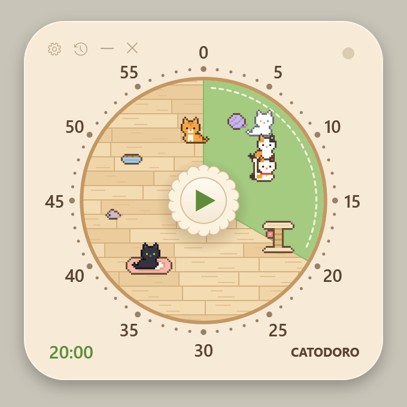
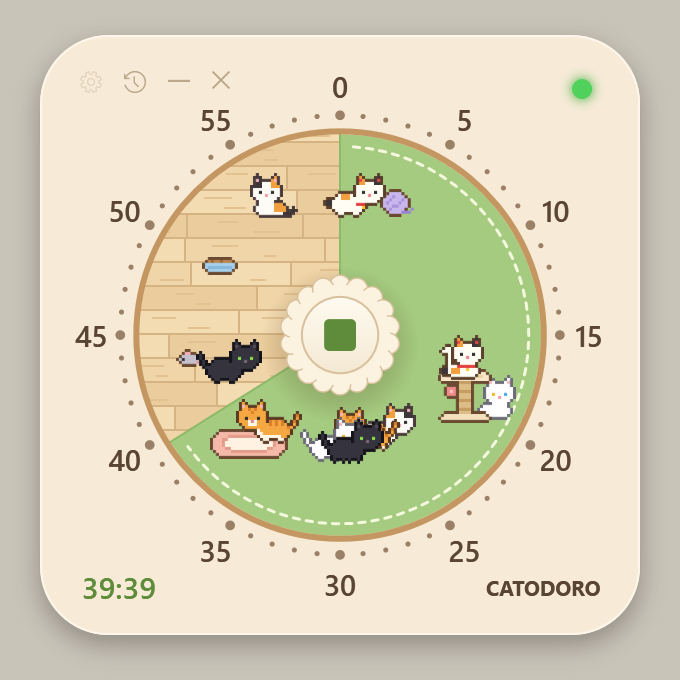
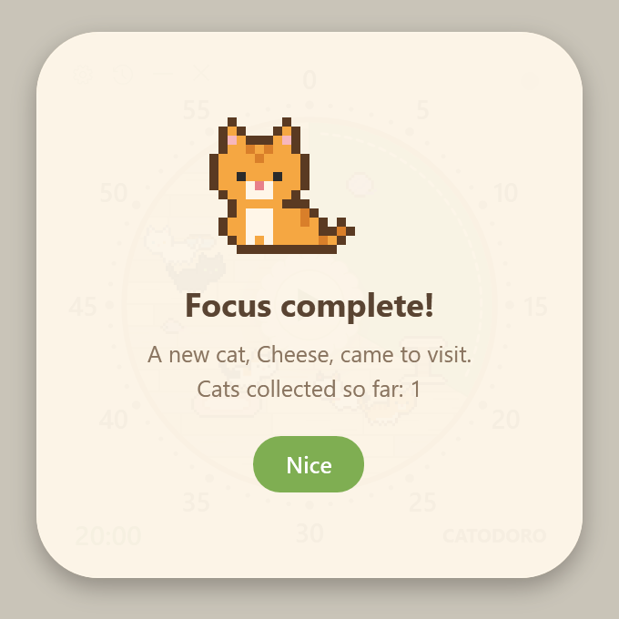
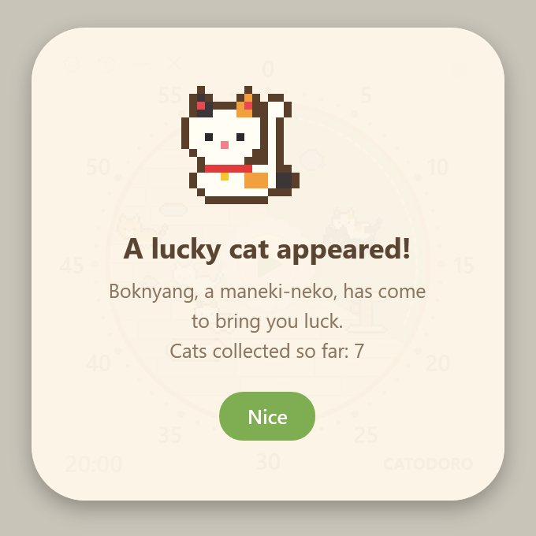
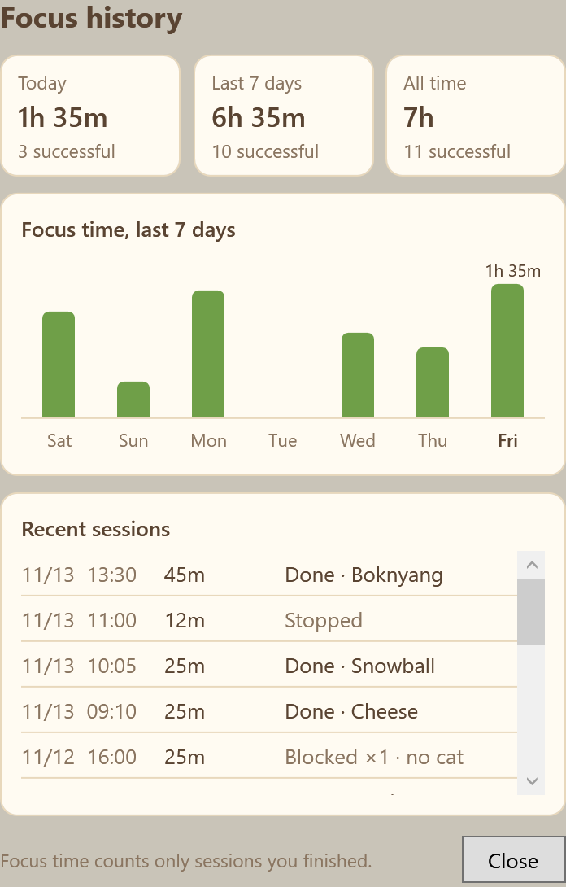

# Catodoro 🐈

[한국어](README.md) | **English**

A Pomodoro timer where pixel cats wander around (Windows 10/11).

**[⬇ Download Catodoro.exe](https://github.com/yeojin5/catodoro/releases/latest/download/Catodoro.exe)** · [All releases](https://github.com/yeojin5/catodoro/releases)

There is no installer: download the exe and run it. If Windows shows "Windows protected your PC" on first run, click **More info → Run anyway**.

Turn the dial to set a focus time. If you stay away from your distractions (the programs and sites you chose) until the time is up, a pixel cat comes to live in the wood-floor playground inside the dial. Now and then the cats curl up on the cushion or hop onto the cat tower.

The interface is available in English and Korean. It follows your Windows display language on first run, and you can switch it at the top right of the settings (gear) window.

| Set the time | Focusing | Session complete | Lucky cat |
| :---: | :---: | :---: | :---: |
|  |  |  |  |
| Turn the dial, then press ▶ in the center | The green rug shrinks as time passes | Stay focused to the end and a cat arrives | 10% chance of a maneki-neko |

## How to use

1. Run the `Catodoro.exe` you downloaded from the link above. Nothing is installed.
2. Drag the dial with the mouse (or use the scroll wheel) to set a time between 0 and 60 minutes.
3. Press the **center knob (▶)** to start. Press it again during a session (■) and it asks whether you want to stop.
4. Click the **gear** in the top-left corner to choose the programs and sites to block during focus time.
5. If you never open anything on the block list before the time is up, you get a cat.
   - It is one of four cats at random: Patches (calico), Shadow (black), Cheese (orange tabby) or Snowball (white).
   - There is a 10% chance of the lucky cat **Boknyang** (a maneki-neko). It wears a red collar with a gold bell and waves its paw while sitting.
   - If you try to open something on the block list, it is closed right away and no cat comes for that session (the indicator light turns red).

Drag an empty part of the body to move the window.

### Focus history

Click the **clock button** in the top-left corner to open your focus history: focus time and successful sessions for today, the last 7 days and all time, a 7-day chart, and a list of sessions (done, blocked, stopped).
Focus time counts only sessions you finished; sessions you stopped early appear in the list only.



## How blocking works

- **Programs**: an exe on the list is terminated as soon as it starts.
  Ones that were already running when the session started are closed without counting as an attempt.
- **Sites**: Catodoro reads the address of the tab currently shown in each browser window and closes that tab if its domain is on the list.
  Only the address you list is blocked. `youtube.com` blocks YouTube (including its www and mobile addresses), while subdomains such as `music.youtube.com` stay open.
  To block every subdomain as well, put `*.` in front, as in `*.naver.com`.
  It needs no administrator rights and does not touch the hosts file.
  It watches Chrome, Edge, Whale, Brave, Opera, Vivaldi and Firefox windows (actually tested: reading in Chrome, reading and closing in Edge).

### Good to know

- Only the **visible tab** of each window is checked. A background tab or a minimized window is handled when you switch to it.
- Ending Catodoro from Task Manager lifts the block. It is a tool to help your willpower, not a security tool.
- Programs running as administrator may not be terminated.
- Settings, cats and focus history are saved in `%AppData%\Catodoro\settings.json`.

## Build it yourself

All you need is the [.NET SDK](https://dotnet.microsoft.com/download) (8 or later).

```bash
dotnet build Catodoro.csproj -c Release
```

The output is a single file, `bin\Release\Catodoro.exe` (about 100 KB).
It targets .NET Framework 4.8, which ships with Windows, so people who download it do not need to install anything.

## Project layout

| File | Role |
| --- | --- |
| `src/MainWindow.xaml(.cs)` | Main timer window and the focus session flow |
| `src/DialControl.cs` | Drawing the dial (wood floor and rug) and handling the mouse |
| `src/CatSprites.cs` | The four pixel cats and the lucky cat (drawn in code) |
| `src/PropSprites.cs` | Playground props: cat tower, cushion, bowl, yarn, toy mouse (drawn in code) |
| `src/CatLayer.cs` | Where the props go and how the cats walk around |
| `src/Blocker.cs` | Blocking programs and sites |
| `src/SettingsWindow.xaml(.cs)` | Block list settings window |
| `src/HistoryWindow.xaml(.cs)` | Focus history window (summary, chart, list) |
| `src/Store.cs` | Saving settings, cats and focus history |
| `src/Theme.cs` | Colors used by the code-drawn parts |
| `src/Lang.cs` | UI text (Korean and English) |
| `src/AssetExporter.cs` | Icon generation (`Catodoro.exe --export-assets <folder>`) |
