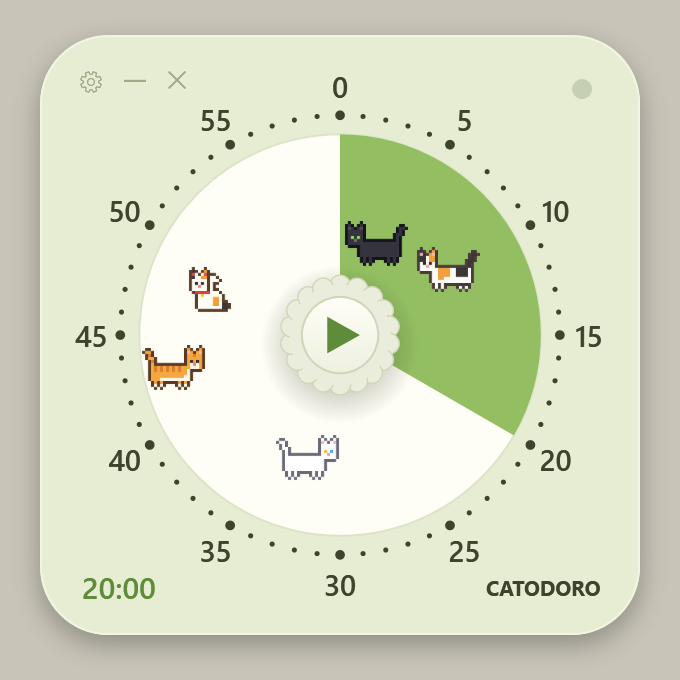
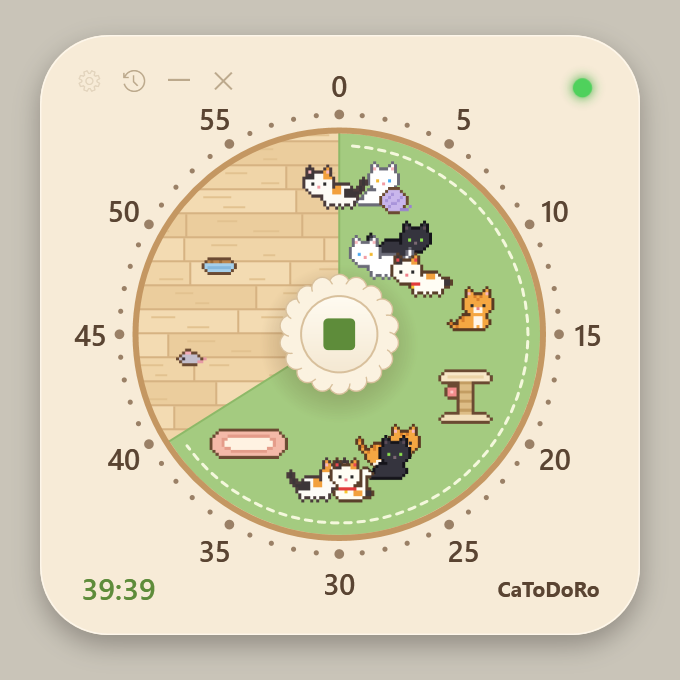
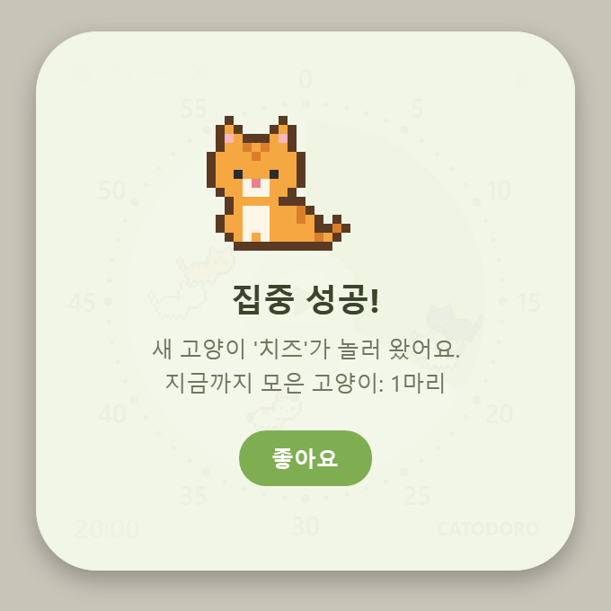
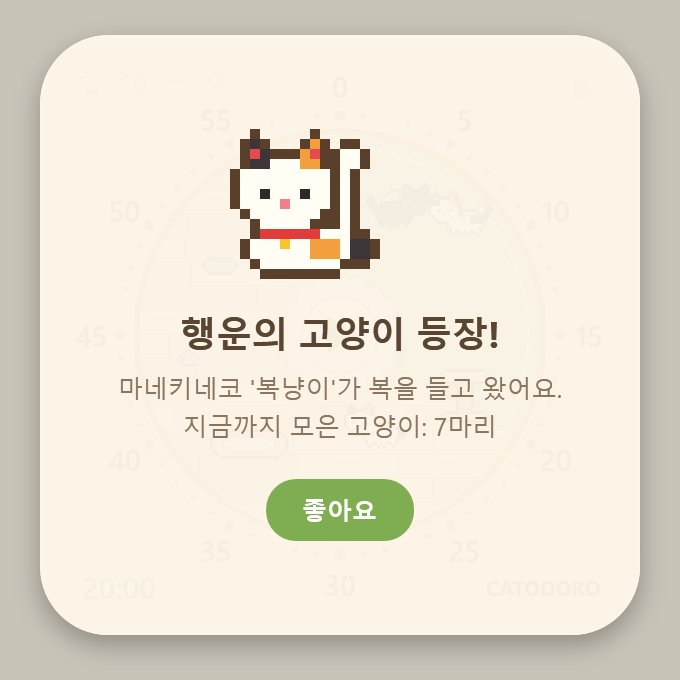
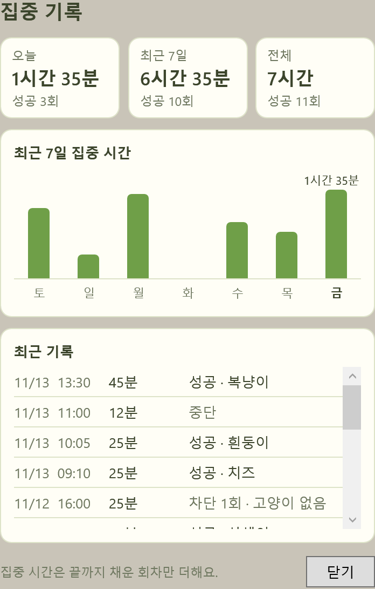

# Catodoro 🐈

**한국어** | [English](README.en.md)

고양이가 돌아다니는 뽀모도로 타이머 (Windows 10/11).

**[⬇ Catodoro.exe 내려받기](https://github.com/yeojin5/catodoro/releases/latest/download/Catodoro.exe)** · [모든 버전 보기](https://github.com/yeojin5/catodoro/releases)

설치 없이 내려받은 exe 를 실행하면 됩니다. 처음 실행할 때 "Windows의 PC 보호" 창이 뜨면 **추가 정보 → 실행**을 누르세요.

다이얼을 돌려 집중 시간을 맞추고, 그 시간 동안 딴짓(지정한 프로그램·사이트)을 하지 않으면
픽셀 고양이 한 마리가 타이머의 둥근 판 안에 놀러 와서 돌아다닙니다.

| 시간 맞추기 | 집중 중 | 집중 성공 | 행운의 고양이 |
| :---: | :---: | :---: | :---: |
|  |  |  |  |
| 다이얼을 돌려 시간을 맞추고 가운데 ▶ 를 누릅니다 | 남은 시간만큼 초록색이 줄어듭니다 | 끝까지 참으면 고양이가 옵니다 | 10% 확률로 마네키네코가 옵니다 |

## 사용법

1. 위 링크에서 받은 `Catodoro.exe` 를 실행합니다. 설치 과정은 없습니다.
2. 다이얼을 마우스로 끌어서(또는 휠로) 0~60분 사이로 시간을 맞춥니다.
3. 다이얼 **가운데 손잡이(▶)** 를 누르면 집중 시작. 집중 중에 다시 누르면(■) 그만둘지 물어봅니다.
4. 왼쪽 위 **톱니바퀴**에서 집중 시간 동안 막을 프로그램과 사이트를 고릅니다.
5. 시간이 다 될 때까지 차단 목록을 한 번도 열지 않으면 고양이가 생깁니다.
   - 고양이는 4종(삼색이·까망이·치즈·흰둥이) 중 무작위입니다.
   - 10% 확률로 행운의 고양이 **복냥이**(마네키네코)가 옵니다. 빨간 목줄에 금방울을 달고, 앉아서 앞발로 손짓합니다.
   - 차단 목록을 열려고 하면 바로 닫히고, 그 회차에는 고양이가 오지 않습니다(표시등이 빨간색으로 바뀜).

몸체의 빈 곳을 끌면 창을 옮길 수 있습니다.

### 집중 기록

왼쪽 위 **시계 모양 버튼**을 누르면 집중 기록이 열립니다. 오늘·최근 7일·전체 집중 시간과 성공 횟수, 최근 7일 그래프, 회차별 목록(성공·차단·중단)을 볼 수 있습니다.
집중 시간에는 끝까지 채운 회차만 더하고, 도중에 그만둔 회차는 목록에만 남습니다.



화면 언어는 한국어와 영어를 지원합니다. 처음에는 윈도우 표시 언어를 따르고, 설정 창(톱니바퀴) 오른쪽 위에서 바꿀 수 있습니다.

## 차단은 이렇게 동작합니다

- **프로그램**: 목록에 있는 exe 가 실행되면 바로 종료합니다.
  집중을 시작할 때 이미 켜져 있던 것은 닫기만 하고 "접근"으로 세지 않습니다.
- **사이트**: 브라우저 창에 지금 보이는 탭의 주소를 읽어, 목록의 도메인이면 그 탭을 닫습니다.
  목록에 적은 주소만 막습니다. `youtube.com` 을 넣으면 유튜브(www·모바일 주소 포함)만 막히고, `music.youtube.com` 같은 하위 주소는 그대로 열립니다.
  하위 주소까지 전부 막으려면 `*.naver.com` 처럼 앞에 `*.` 을 붙여 적습니다.
  관리자 권한이 필요 없고 hosts 파일을 건드리지 않습니다.
  Chrome·Edge·Whale·Brave·Opera·Vivaldi·Firefox 창을 살핍니다(실제 확인은 Chrome 읽기, Edge 읽기·닫기까지 했습니다).

### 알아 둘 점

- 사이트는 **화면에 보이는 탭**만 검사합니다. 뒤에 숨은 탭이나 최소화된 창은 그 탭을 볼 때 닫힙니다.
- 작업 관리자에서 Catodoro 를 강제 종료하면 차단도 풀립니다. 의지를 돕는 도구이지 보안 도구가 아닙니다.
- 관리자 권한으로 실행된 프로그램은 종료하지 못할 수 있습니다.
- 설정, 고양이, 집중 기록은 `%AppData%\Catodoro\settings.json` 에 저장됩니다.

## 직접 빌드하기

[.NET SDK](https://dotnet.microsoft.com/download) (8 이상) 만 있으면 됩니다.

```bash
dotnet build Catodoro.csproj -c Release
```

결과물은 `bin\Release\Catodoro.exe` 하나입니다(약 100KB).
Windows 에 기본으로 들어 있는 .NET Framework 4.8 을 쓰기 때문에, 받는 사람은 아무것도 설치할 필요가 없습니다.

## 폴더 구조

| 파일 | 역할 |
| --- | --- |
| `src/MainWindow.xaml(.cs)` | 타이머 본체 화면, 집중 시간 진행 |
| `src/DialControl.cs` | 돌리는 다이얼 그리기와 마우스 처리 |
| `src/CatSprites.cs` | 픽셀 고양이 4종 + 행운의 고양이 그림(코드로 그림) |
| `src/CatLayer.cs` | 고양이들이 걸어 다니는 움직임 |
| `src/Blocker.cs` | 프로그램·사이트 차단 |
| `src/SettingsWindow.xaml(.cs)` | 차단 목록 설정 창 |
| `src/HistoryWindow.xaml(.cs)` | 집중 기록 창(요약·그래프·목록) |
| `src/Store.cs` | 설정·고양이·집중 기록 저장 |
| `src/Theme.cs` | 코드로 그리는 부분의 색 |
| `src/Lang.cs` | 화면 문구(한국어·영어) |
| `src/AssetExporter.cs` | 아이콘 생성 (`Catodoro.exe --export-assets <폴더>`) |
